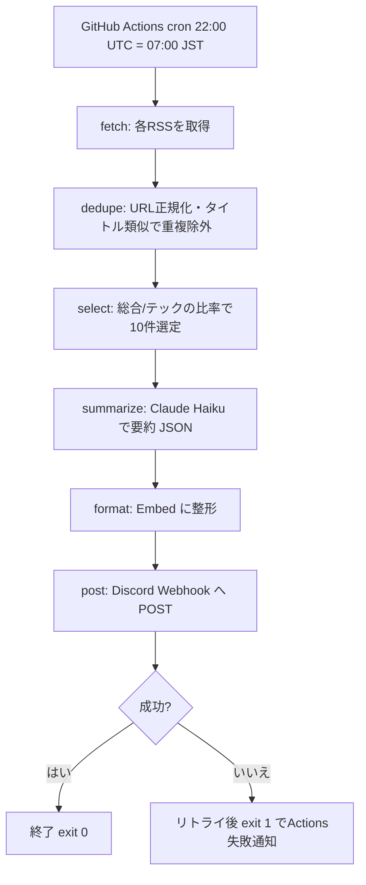

# のむしょう 設計概要

状態: 実装済み(2026-10-29)。設計時点からの変更点は末尾の「実装時の変更点」を参照。

## 1. 目的

個人の Discord サーバーに、毎朝 7:00(JST)に「今日のニュース」(総合+テック)10件を要約して投稿する。利用者は自分1人。

## 2. スコープ

### 今回やる
- GitHub Actions の cron で1日1回実行(常駐 Bot なし)
- RSS から記事取得 → 重複除外 → 10件選定 → Claude で要約 → Discord Webhook で投稿
- 各記事は「見出し + 1〜2行の要約 + 元記事リンク」
- 環境変数でモデル・件数・ソースを調整可能
- `workflow_dispatch` による手動実行、`--dry-run`(投稿せず標準出力)

### 今回やらない
- 常駐 Bot / スラッシュコマンド(`/news` 等)
- 複数サーバー・複数ユーザー対応、ジャンルのユーザー別設定
- 記事本文のスクレイピング(RSS が持つタイトル・概要のみ使う)
- 既読管理用の DB(重複除外は同一実行内のみ。日跨ぎ重複は「未決事項」参照)

## 3. 処理フロー



## 4. ディレクトリ構成(実装)

```
のむしょう/
├── .github/
│   ├── workflows/
│   │   ├── daily-news.yml     # cron + workflow_dispatch(本番投稿 / dry_run 入力)
│   │   └── ci.yml             # push(main) / PR で ruff + pytest
│   └── dependabot.yml         # pip / github-actions を週次で更新確認
├── src/nomusyo/
│   ├── core/                  # Discord 非依存(将来の常駐Bot化でも再利用)
│   │   ├── models.py          # Source, Article, SummarizedArticle の dataclass
│   │   ├── sources.py         # ソース定義(名前・URL・ジャンル)
│   │   ├── fetcher.py         # requests + feedparser による取得
│   │   ├── dedupe.py          # 重複除外
│   │   ├── selector.py        # 件数配分・選定
│   │   ├── summarizer.py      # Anthropic SDK による要約
│   │   └── pipeline.py        # run_pipeline() -> list[SummarizedArticle]
│   ├── discord_io/            # Discord 依存部分
│   │   ├── formatter.py       # Embed 整形・文字数制限・分割
│   │   └── webhook.py         # Webhook 送信(リトライ含む)
│   ├── config.py              # 環境変数読み込み
│   └── main.py                # エントリポイント(python -m nomusyo.main)
├── tests/                     # test_config / dedupe / fetcher / formatter / main / pipeline / selector / summarizer / webhook
├── pyproject.toml             # 依存・ruff・pytest 設定
├── docs/
│   ├── design/                # 設計(本文書ほか)
│   ├── operations.md          # 運用手順
│   └── archive/               # 過去の別構想(参照不要)
└── README.md
```

依存方向: `main` → `discord_io` / `core`。`core` は `discord_io` を import しない。

## 5. 技術選定と理由

| 項目 | 選定 | 理由 |
|---|---|---|
| 実行基盤 | GitHub Actions cron | 常駐不要、無料枠内、サーバー管理なし |
| 投稿 | Discord Webhook | Bot トークン・Intents 不要。最小構成に最適 |
| 言語 | Python 3.11+ | 要件。標準の `zoneinfo`、`tomllib` が使える |
| RSS | feedparser | 事実上の標準、RSS/Atom 差異を吸収 |
| HTTP | requests | Webhook 送信と RSS 取得。タイムアウト・リトライを明示 |
| 要約 | Anthropic SDK、既定 `claude-haiku-5-5` | 安価。`SUMMARY_MODEL` で変更可 |
| テスト/Lint | pytest / ruff | CLAUDE.md の規約 |

## 6. 設定 / Secrets

### GitHub Secrets(必須)
| 名前 | 用途 |
|---|---|
| `DISCORD_WEBHOOK_URL` | 投稿先 Webhook(漏洩=誰でも投稿可なので秘匿、ログ出力禁止) |
| `ANTHROPIC_API_KEY` | 要約 API |

### 環境変数(任意、既定値あり。Actions では `env:` か Variables)
| 名前 | 既定 | 説明 |
|---|---|---|
| `SUMMARY_MODEL` | `claude-haiku-5-5` | 要約モデル |
| `NEWS_TOTAL_COUNT` | `10` | 総件数 |
| `NEWS_GENERAL_RATIO` | `0.5`(5件/5件) | 総合の比率(0〜1)。総合枠は `floor(件数×比率+0.5)` |
| `NEWS_MAX_AGE_HOURS` | `36` | これより古い記事は除外 |
| `DRY_RUN` | `false` | true で投稿せず出力のみ |
| `LOG_LEVEL` | `INFO` | ログレベル |

ローカル開発は `.env`(コミット禁止、`.gitignore` に追加)。

## 7. コスト見積り

- GitHub Actions: 1回 約1分 × 30回/月 = 約30分。無料枠(個人: 月2,000分、public リポジトリは無制限)に対して十分小さい。
- Anthropic API: 1日 10件 × (入力 約500〜800 tok + 出力 約100 tok) + 指示文。1回あたり入力 約8k、出力 約1.5k tok 程度。月30回で入力 約0.25M、出力 約0.05M tok。Haiku クラスの単価なら月額は数十円〜数百円以内の見込み(単価は公式料金表で要確認)。
- 候補を多めに渡して選定もさせる設計(未決)にしても入力が数倍になる程度で、月額は同オーダー。

## 8. 将来の常駐 Bot 化の方針

- `core/` は Discord・環境変数・グローバル状態に依存しない純粋なモジュールとし、`run_pipeline(config) -> list[SummarizedArticle]` を公開 API とする。
- 常駐化する場合は `bot/` を追加し、discord.py の Cog(例: `NewsCog`)で `/news` コマンドから `core.pipeline` を呼ぶ。応答の整形は `discord_io/formatter.py` を再利用。
- 必要な Intents: スラッシュコマンドのみなら default(特権 Intents 不要)。
- 要約の同期 API 呼び出しは `asyncio.to_thread` で包む(イベントループをブロックしない)。
- 定期投稿を Bot 側で行う場合は `discord.ext.tasks` を使い、Actions 側は停止する(二重投稿防止)。
- 常駐先(VPS、Fly.io 等)は将来決定。今は設計しない。

## 未決事項

| # | 論点 | 選択肢 | 推奨 |
|---|---|---|---|
| 1 | 総合/テックの比率 | 5:5 / 4:6 / 6:4 | 5:5(環境変数で可変) |
| 2 | 日跨ぎの重複防止 | なし / `seen.json` を Actions cache or リポジトリにコミット | 初回は「なし」+ 公開時刻フィルタ(直近36h)。不足なら後で追加 |
| 3 | HTTP ライブラリ | requests / httpx | requests(同期で十分、依存が軽い) |
| 4 | Discord 用パッケージ名 | `discord/` / `discord_io/` | `discord_io/`(discord.py との衝突回避) |
| 5 | リポジトリ公開範囲 | public / private | private でも無料枠で足りる。Secrets 運用は同じ |
| 6 | 要約モデル ID | `claude-haiku-5-5` をそのまま使用 | 実装時に API で実在確認し、存在しなければリードへ報告 |
| 7 | 依存管理 | pip + requirements / pyproject + uv | pyproject.toml + pip(Actions で簡素) |

## 実装時の変更点

未決事項の決定結果:

| # | 決定結果 |
|---|---|
| 1 | 総合/テック比率は既定 0.5(5:5)。`NEWS_GENERAL_RATIO` で可変 |
| 2 | 日跨ぎの重複防止は実装していない(`NEWS_MAX_AGE_HOURS` の公開時刻フィルタのみ)。F01 として将来扱い |
| 3 | HTTP ライブラリは requests |
| 4 | パッケージ名は `discord_io/` |
| 5 | リポジトリ公開範囲はコード・ワークフローからは判断できないため未記載(`docs/operations.md` は公開リポジトリの 60 日無効化に言及) |
| 6 | 既定モデルは `claude-haiku-5-5` のまま。実在確認は未実施(ユーザーの初回手動実行で確認。存在しないと恒久エラーで exit 1) |
| 7 | 依存管理は `pyproject.toml` + pip(Actions は `pip install .`、CI は `pip install -e '.[dev]'`) |

その他の変更・追加:

- 失敗時の終了コード: 要約 API の恒久的エラー(キー無効・権限なし・モデル不存在・不正リクエスト)は、フォールバック表示で投稿した後に exit 1(処理フロー図の「成功なら exit 0」はこの場合に当てはまらない)。詳細は `news-pipeline.md`。
- CI(`ci.yml`)と dependabot(`dependabot.yml`)を追加した。
- ワークフローの Run ステップが渡す env は Secrets 2つと `DRY_RUN` のみ。それ以外の設定を変えるには `env:` への追記が必要。
- 挙動の詳細は `README.md`、`docs/operations.md`、コードが正。
