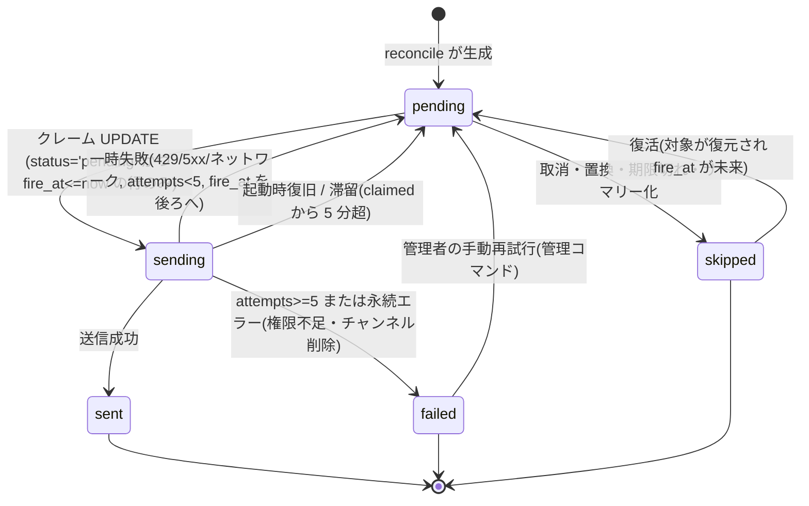

# スケジュール機能 データモデル確定版

状態: 設計(未実装)。`schedule.md` 3 章・4 章の穴を埋め、**このファイルを DB スキーマの正とする**(`schedule.md` 3.3 の DDL 案および `decisions.md` S7/S11/S12 を具体化・上書きする。食い違う場合は本書を優先)。
前提: `resident-bot.md`、`decisions.md`、`tasks-v2.md`。実装済みの `src/nomusyo/bot/config.py` を現状として読んだ。
外部仕様に確信が持てない点は「要確認」。

## 0. 結論の要約

| # | 論点 | 結論 |
|---|---|---|
| 1 | 繰り返しの例外 | occurrence(各回)はテーブル化せず、**events(親)+ event_exceptions(skip / override)**で表す。各回の識別子は `(event_id, occurrence_local)`(RRULE が生む**元の**壁時計開始時刻)。通知は同じキーに紐づけ、時刻を動かす override でもキーは変わらない。「これ以降」は**系列の分割**(旧 event に UNTIL、新 event を作成)で実現する。例外テーブルはフェーズ3(V2-60)で追加するが、必要な列(`rrule`、`series_id`、`start_utc/until_utc` 等)はフェーズ2の `events` に最初から置く |
| 2 | TODO のリマインド | `reminder_rules` と `notifications` を**予定と共通化**(`event_id` / `todo_id` の排他 2 列 + CHECK)。期限なし TODO は通知なし(ダイジェストと一覧のみ)。期限切れは催促を繰り返さず「期限時刻の通知 1 回」+ ダイジェスト毎朝表示。完了・削除で未送信を `skipped` に倒し、再開で復活 |
| 3 | 障害通知先 | 実装済みの **`ADMIN_USER_ID`(DM)を正**とする(未指定は `ALLOWED_USER_IDS` の先頭)。`ADMIN_CHANNEL_ID` は任意の上書き(設定時はチャンネル優先、失敗時は DM)。**`ADMIN_DM` は導入しない** |
| 4 | BotConfig の追加 | 環境変数に足すのは `DB_PATH` / `TZ_DEFAULT` / `DIGEST_TIME` / `NEWS_POST_TIME` / `NEWS_POST_ENABLED` / `ADMIN_CHANNEL_ID` の 6 つのみ。実行時に変える値は `settings` テーブル、調整値は定数。優先順位は settings > env > 既定値 |
| 5 | スキーマ管理 | `migrations/NNNN_name.sql` の連番、`schema_version` に履歴(version/name/checksum)。1 マイグレーション = 1 トランザクション。適用前に backup API でバックアップ。ダウングレードなし(新しすぎる DB は起動拒否) |
| 6 | マイグレーション順 | 0001(フェーズ2)events / todos / reminder_rules / settings / job_runs / instance_lock → 0002(V2-52)notifications → 0003(V2-60)event_exceptions → 0004(V2-83)usage_counters |
| 7 | 通知の冪等性 | `dedupe_key`(文字列の UNIQUE)で一意化。NULL を含む UNIQUE の穴を避ける。**行の同一性は dedupe_key、送信時刻は属性**とし、再生成は差分適用(挿入・時刻更新・skipped 化・復活) |

## 1. 時刻・ID の規約(全テーブル共通)

| 種別 | 形式 | 例 | 備考 |
|---|---|---|---|
| UTC 時刻 | `YYYY-MM-DDTHH:MM:SSZ`(20 文字、秒精度) | `2026-11-03T06:00:00Z` | 固定長なので辞書順 = 時刻順。列名は `*_utc` |
| 壁時計時刻 | `YYYY-MM-DDTHH:MM:SS`(19 文字、オフセットなし) | `2026-11-03T15:00:00` | 列名は `*_local`。対応する IANA 名は同じ行の `tz` |
| 終日 | 壁時計の `YYYY-MM-DDT00:00:00` + `all_day=1` | | 形式を 1 種類に統一するため日付のみの文字列は使わない |
| 日付(ジョブ) | `YYYY-MM-DD`(`TZ_DEFAULT` での日付) | | `job_runs.run_date` |
| 主キー | 主要テーブルは `INTEGER PRIMARY KEY AUTOINCREMENT` | | 削除済み ID の再利用を避ける(表示 ID がそのまま通知キーになるため) |
| Discord ID | `INTEGER`(64bit) | | 現行のスノーフレークは符号付き 64bit に収まる |

- 派生列(`start_utc`、`until_utc`、`due_utc`、`ov_start_utc`)は壁時計 + `tz` から**サービス層の 1 箇所**で計算して書く(Repository 内の関数 1 つ)。tzdata 更新で UTC 換算がずれる可能性があるため、管理コマンドで再計算できる関数を用意する(JST は夏時間なしのため当面影響は小さい。要確認)。
- naive datetime 禁止(`schedule.md` 3.2)は維持。DB から読んだ `*_local` は `tz` 付きで aware に変換して扱う。
- 論理削除は `deleted_at_utc`。物理削除(purge)は 90 日経過後に日次メンテナンスで行う(未決 N6)。

## 2. 繰り返しと例外(S7)

### 2.1 方式の比較と決定

| 案 | 内容 | 長所 | 短所 | 判定 |
|---|---|---|---|---|
| A. 例外テーブル | events に RRULE、`event_exceptions` に (event_id, 元の発生時刻) 単位で `skip` / `override` | キーが自然、skip と override を同じ表で扱える、iCal の EXDATE / RECURRENCE-ID にそのまま対応(フェーズ5の取り込み・エクスポートが素直) | 展開時に例外のマージが必要 | **採用** |
| B. EXDATE 列 + 子 event | events に除外日の JSON、変更回は `recurrence_of` を持つ子 event 行 | 変更回が独立した予定として扱える | 一覧・検索で子行の除外が必要、列が 2 系統、整合が崩れやすい | 不採用 |
| C. occurrences を全件テーブル化 | 展開結果を行として保持 | 参照が単純 | 無期限繰り返しは窓だけ、真実が二重化(RRULE と行)、編集時の再生成が重い | 不採用 |

occurrence は**仮想概念**(テーブルなし)。`expand(event, window, exceptions) → [Occurrence]` が唯一の展開関数で、フェーズ2では単発予定 1 件を返すだけ。`/today` `/week` `/list` ダイジェストは最初からこの関数経由にして、フェーズ3で RRULE 展開を差し込んでも呼び出し側を変えない。**これがフェーズ2に置く最大の「余地」**。

### 2.2 occurrence の識別子

`OccurrenceKey = (event_id, occurrence_local)`

- `occurrence_local` は **RRULE(+ DTSTART)が生成した元の壁時計開始時刻**。override で時刻を動かしても変えない(動かした先は `ov_start_local`)。通知キー・例外キー・ボタン解決のすべてがこれを使うので、「この回」が編集後も同じものを指し続ける。
- 単発予定は `occurrence_local = dtstart_local`。単発の時刻編集は別の発生とみなし、キーが変わる(旧キーの未送信通知は skipped、新キーで生成。4.4 参照)。
- 通知のボタン `custom_id` は `n:{notification_id}:{action}` のみ(100 文字上限に余裕。要確認: 上限値)。occurrence は通知行から引く。

### 2.3 範囲選択の意味と DB への効果

「対象の回」= ユーザーが選んだ発生(オートコンプリートで選んだ `event_id` + `occurrence_local`)。

| 操作 | 単発 | この回のみ | これ以降 | すべて |
|---|---|---|---|---|
| 削除 | `deleted_at_utc` を立てる | `event_exceptions` に `skip` を UPSERT | 親の RRULE に UNTIL(対象の直前、UTC)を設定。対象以降の例外を削除。対象が初回なら「すべて」と同じ | 親を論理削除(例外は残す。復元用) |
| 変更 | `events` を UPDATE | `override` を UPSERT(変更した項目のみ非 NULL) | **分割**(2.4) | 親の UPDATE |
| 通知への効果 | 4.4 の reconcile | 対象 occurrence のみ reconcile | 旧 event・新 event を reconcile | 親の全 occurrence を reconcile |

- override の NULL 列は「親を継承」。親のタイトル変更は、タイトルを上書きしていない override にも反映される。全項目 NULL の override は保存しない(サービス層で拒否)。
- 「すべて」で `dtstart_local` の時刻部分・曜日・`rrule` を変えると、既存の `occurrence_local` が展開結果と一致しなくなる。この場合、**孤児になる例外は削除する**。確認画面に「N 件の個別変更が破棄されます」を出す(未決 N4)。タイトル・場所・メモ・通知設定の変更は例外に影響しない。
- 「すべて」の範囲は**対象 occurrence が属する event 行**(分割済みなら対象の系列セグメント)。UI の文言を「この予定の全回(分割前後の別系列は含まない)」とする(未決 N1)。
- RRULE が COUNT を持つ場合、分割や UNTIL 設定では COUNT を UNTIL に変換する(旧: 対象直前の最終回を UNTIL に、新: 残り回数を COUNT に)。dateutil の `count` と `until` は併用できないため(要確認)。
- UNTIL は UTC で保持(`decisions.md` S12)。`rrule_until` 列は設けない(`schedule.md` の旧案から削除)。

### 2.4 「これ以降」の分割手順(1 トランザクション)

1. 旧 event `M` の RRULE を UNTIL = `T` の直前(対象 occurrence の前回、または `T` の 1 秒前を UTC 換算)に更新。`until_utc` も更新。
2. 新 event `N` を INSERT: `dtstart_local = T`(時刻変更ありなら新時刻)、変更後の項目、同じ RRULE(UNTIL/COUNT は元の終端を引き継ぐ)、`series_id = COALESCE(M.series_id, M.id)`。`reminder_rules` を `M` から複製。
3. `M` の `occurrence_local >= T` の例外を `N` へ移す(`UPDATE event_exceptions SET event_id = N.id`)。
4. `M` と `N` を reconcile(4.4)。`M` の `T` 以降の未送信は `skipped('superseded')`、`N` の通知が生成される。送信済みの通知は `M` に残る(履歴)。

`series_id` は系列の根(最初の event の `id`)。単発・未分割は NULL。履歴表示と将来の「系列全体」操作用で、フェーズ2から列だけ持つ。

### 2.5 展開アルゴリズム(参考。実装は `recurrence.py`)

1. 候補 event を SQL で絞る: `deleted_at_utc IS NULL AND start_utc < :window_end AND (until_utc IS NULL OR until_utc >= :window_start)`。ここに、`event_exceptions` の override のうち `ov_start_utc` が窓内のものを持つ event を OR で加える(窓の外の元の回を窓内へ動かした場合のため)。
2. `rrulestr(rrule, dtstart=dtstart_local(aware, tz))` で窓内の発生を展開(壁時計維持)。
3. `skip` の回を除外、`override` を適用(NULL は継承)。窓内へ動いてきた override を追加。
4. `skip_holidays=1` なら祝日の回を除外(フェーズ3、V2-62)。
5. 展開結果の各 `Occurrence` は `(event_id, occurrence_local, effective_start_utc, effective_end_utc, title, place, note, all_day)`。

## 3. TODO のリマインド(S11)

### 3.1 結論: 共通化

`reminder_rules` と `notifications` は予定と TODO で共通にする。理由: ディスパッチ・バックオフ・取りこぼし再送・スヌーズ・まとめ送信・永続ボタン・`/status` の件数が 1 系統で済み、テストも 1 回で足りる。差は「対象への参照」と「発生の概念」のみ。

- 対象参照は `event_id` / `todo_id` の**排他**(CHECK で「どちらか一方のみ」)。ポリモーフィックな 1 本の対象 ID 列は FK が張れないため不採用。
- TODO の「発生」は期限そのもの。`notifications.occurrence_local` には**通知生成時点の `due_local`** を入れる(期限を変更したら別キーになり、送信済みの通知があっても新しい期限で再度リマインドできる)。
- 別表にした場合は、ディスパッチャが 2 系統、`/status` や取りこぼしサマリーも 2 系統になり、重複が多い。不採用。

### 3.2 TODO の種別ごとの扱い

| ケース | 通知 |
|---|---|
| 期限なし | **通知なし**。`reminder_rules` を保存しない(`/todo add` で `remind` のみ指定されたらエラー「期限が必要です」)。一覧・`/today`・ダイジェストの「期限なし」欄に出るだけ(未決 N3) |
| 時刻付き期限 | `reminder_rules`(`offset_min` または `at_local + day_offset`)の通知 + 期限時刻ちょうどの `due` 通知(設定 `notify_at_due`、既定オン) |
| 日付のみ期限(`due_all_day=1`) | `offset_min` 規則は不可(エラー)。`at_local + day_offset` のみ。指定がなければ既定は「当日 `all_day_notify_time`(08:00)」。`due` 通知も同時刻 |
| 期限切れ(未完了) | 超過後に催促を**繰り返さない**。`/todo list overdue` と毎朝ダイジェストの「期限切れ」欄、`/today` に出す。過去の未送信リマインドは取りこぼし処理(3.3)でサマリー化(未決 N2) |
| 完了 | 同一トランザクションで `done_at_utc` を立て、その TODO の `pending` を `skipped('todo_done')`。通知メッセージの「完了」ボタンも同じ処理 |
| 完了の取消(再開) | `done_at_utc` を NULL にし reconcile。`todo_done` で skipped になっていた行のうち `fire_at_utc > now` のものを `pending` に**復活**(4.4) |
| 削除 | `deleted_at_utc` + `skipped('target_deleted')`。復元時は同様に復活 |
| 期限の変更 | reconcile(`occurrence_local` が新期限になるため旧キーの未送信は `superseded`、新キーが生成される) |
| 繰り返し TODO | 対象外(必要になったら別途設計)。`todos` に rrule 列は持たない |

デフォルトリマインドは**作成時にコピー**して `reminder_rules` 行にする(後で `/settings` の既定を変えても既存データは変わらない)。予定・TODO で既定値は別設定(`default_remind` / `default_remind_todo`)。

### 3.3 取りこぼしの TODO / 予定の扱い(`schedule.md` 4.3 の確定版)

起動時・復帰時の `pending AND fire_at_utc <= now` 行は、遅れ `delay = now - scheduled_utc` と対象時刻 `target_utc`(予定の開始、TODO の期限)で分類する。

| 条件 | 処理 |
|---|---|
| `delay <= late_grace`(既定 10 分) | 通常通知 |
| `delay > late_grace` かつ `now < target_utc` | `late=1` で「遅延(本来 HH:MM)」付き通知 |
| `now >= target_utc`(予定は開始済み、TODO は期限超過) | 個別送信しない。「不在中に過ぎた予定/期限」1 通にまとめる。含まれた行は `skipped('summarized')`、サマリーの `discord_message_id` を記録 |
| `scheduled_utc < now - 3 日`(`STALE_DAYS`) | `skipped('stale')`。サマリーに件数のみ |

## 4. 通知(notifications)

### 4.1 種別(kind)

| kind | 意味 | `rule_id` |
|---|---|---|
| `remind` | `reminder_rules` に基づく事前リマインド | あり |
| `start` | 予定の開始時刻ちょうど(設定 `notify_at_start`、既定オン。終日は `all_day_notify_time`) | なし |
| `due` | TODO の期限時刻(設定 `notify_at_due`) | なし |
| `snooze` | スヌーズで生成された再通知 | なし(`snooze_of` に親) |

### 4.2 一意キー(dedupe_key)

SQLite の UNIQUE は NULL を重複扱いしないため、`(event_id, occurrence, rule_id, snooze_of)` のような複合 UNIQUE では冪等性が崩れる(`schedule.md` 3.3 の指摘)。生成列の COALESCE ではなく、**アプリが 1 関数で組み立てる文字列 `dedupe_key` を `UNIQUE NOT NULL`** にする。

| 種別 | dedupe_key |
|---|---|
| 予定のリマインド | `e:{event_id}:{occurrence_local}:m{offset_min}` または `e:{event_id}:{occurrence_local}:a{day_offset}@{HHMM}` |
| 予定の開始時刻 | `e:{event_id}:{occurrence_local}:start` |
| TODO のリマインド | `t:{todo_id}:{due_local}:m{offset_min}` / `…:a{day_offset}@{HHMM}` |
| TODO の期限 | `t:{todo_id}:{due_local}:due` |
| スヌーズ | `s:{親notification_id}:{fire_at_utc}` |

- リマインド規則は `rule_id` ではなく**規則の内容**をキーにする。規則の再作成(編集・分割時の複製)で同じ内容なら同じ行として扱われ、送信済みを再送しない。`rule_id` は追跡用の参照(削除時は SET NULL)。
- キーに `fire_at` は含めない(スヌーズを除く)。**同一性 = キー、時刻 = 属性**。予定時刻の変更なしにオフセットを変えるのではなく、規則内容が変われば別キーになる。

### 4.3 状態遷移



| 遷移 | 契機 | 更新内容 |
|---|---|---|
| →pending | reconcile / スヌーズ / 復活 | `fire_at_utc = scheduled_utc`(スヌーズは新しい時刻) |
| pending→sending | ディスパッチ | `attempts+1`、`claimed_at_utc = now`。**`UPDATE ... WHERE id=? AND status='pending'` の影響行数 1 の場合のみ送信** |
| sending→sent | 送信成功 | `sent_at_utc`、`channel_id`、`discord_message_id`、遅れが猶予超なら `late=1` |
| sending→pending(失敗) | 一時エラー | `fire_at_utc = now + バックオフ(30 秒→2 分→10 分→30 分)`、`last_error`(短いコードのみ。本文・タイトルは入れない) |
| sending→pending(復旧) | 起動時・滞留 | `recovered=1`(送信側が「再送(重複の可能性あり)」を付ける) |
| sending→failed | 上限・永続エラー | 管理者へ通知(`ADMIN_USER_ID` / 3 章) |
| pending→skipped | 取消等 | `skip_reason` 必須(CHECK) |

`skip_reason` の語彙と復活可否:

| skip_reason | 発生箇所 | 復活 |
|---|---|---|
| `superseded` | 規則・時刻・期限の変更、分割による置換 | 可(同キーが再び望まれ、`fire_at` が未来なら) |
| `exception_skip` | 「この回のみ削除」の例外 | 可(例外を削除した場合) |
| `target_deleted` | 予定・TODO の論理削除 | 可(復元時) |
| `todo_done` | TODO 完了 | 可(再開時) |
| `acked` | 予定の通知で「完了」ボタン(以降の同じ回の通知を止める) | 不可 |
| `summarized` | 3.3 のサマリーに含めた | 不可 |
| `stale` | 3 日超の古い未送信 | 不可 |
| `past_at_creation` | 作成時点で既に過去(編集・初期バックフィル時) | 不可 |
| `manual` | 管理操作 | 不可 |

### 4.4 reconcile(通知の生成・再生成・取消)

`reconcile(target, mode)` は、対象(event または todo)について「あるべき通知の集合」を計算し、DB との**差分を 1 トランザクションで適用**する。生成・編集・削除・完了・分割・例外・日次補充のすべてがこれ 1 本を通る。

1. **望ましい集合の計算**: 窓 = `[now - STALE_DAYS, now + 35 日(MATERIALIZE_DAYS)]`。予定は 2.5 の展開結果の各 occurrence × (規則 + `notify_at_start`)、TODO は(未完了・未削除・期限あり)の規則 + `due`。各行に `dedupe_key`、`target_utc`(override 反映後の開始/期限)、`scheduled_utc`(規則から算出。終日は `all_day_notify_time` で解決)を計算する。
2. **差分適用**(窓内の `scheduled_utc` を持つ既存行のみ対象。窓外は触らない):

| 状況 | 処理 |
|---|---|
| キーが DB に無い | INSERT。`scheduled_utc` が過去なら `mode` で分岐(下記) |
| キーあり・`pending`・時刻が変わった | `scheduled_utc` / `fire_at_utc` / `target_utc` を更新 |
| キーあり・`pending`・望ましい集合に無い | `skipped`(理由は文脈: `superseded` / `exception_skip` / `target_deleted` / `todo_done`) |
| キーあり・`skipped`(復活可能な理由)・望ましい集合にあり・`fire_at > now` | `pending` に復活 |
| キーあり・`sending` / `sent` / `failed` / 復活不可の `skipped` | **触らない**(送信済みを巻き戻さない) |

3. **過去の `scheduled_utc` の扱い(`mode`)**:
   - `edit`(ユーザー操作)/ `initial`(0002 適用直後の全件バックフィル): 過去は `skipped('past_at_creation')` で INSERT(キーを埋めて、後の補充に蘇らせない)。例: 「10 分前に通知」の予定を 5 分前に登録しても、その分だけ送らない。開始時刻通知は未来なので生成される。
   - `steady`(日次補充・起動時の補充): 過去の `[now - STALE_DAYS, now]` は `pending` で INSERT(長時間停止の穴埋め。3.3 の遅延処理を通る)。
4. **トリガ**: 起動時(`setup_hook`、全対象)、日次補充(`job_runs('materialize')`、`TZ_DEFAULT` の 03:00)、予定/TODO/規則/例外/完了/削除の書き込み直後。
5. **スヌーズ**: 親通知から `kind='snooze'` 行を INSERT(`snooze_of`、`dedupe_key = s:{親id}:{fire_at}`)。同じ対象・同じ occurrence の `pending` なスヌーズが既にあれば `skipped('superseded')`(最新が勝つ)。親が `sent` 以外では押せない。
6. **「完了」ボタン**: 予定は同じ `(event_id, occurrence_local)` の `pending` を `skipped('acked')` + 押された行に `acked_at_utc`(繰り返しでも他の回に影響しない)。TODO は 3.2 の完了処理。
7. **「削除」ボタン**: 単発は論理削除。繰り返しは「この回のみ削除」の `skip` 例外(V2-60 までは繰り返し通知にボタンを出さない)。
8. 1 回の reconcile は SQLite の 1 トランザクション。ループ内の Discord API 呼び出しや LLM 呼び出しは含めない。

### 4.5 例外との整合(まとめ)

| 事象 | 通知への効果 |
|---|---|
| この回のみ削除 | その回の `pending` を `skipped('exception_skip')`。送信済みは残る |
| この回のみ変更(時刻) | 同じキーのまま `pending` 行の `scheduled_utc` / `target_utc` を更新。更新後の `scheduled_utc` が過去になる行は `skipped('past_at_creation')` にする(編集のたびに遅延通知が飛ぶのを防ぐ。要確認 C8) |
| この回のみ変更(タイトル等) | 通知行は不変。送信時に最新のタイトルを読む(通知本文は送信時に生成、行にタイトルを保存しない) |
| これ以降 | 2.4 のとおり |
| 親の削除(すべて) | 全 `pending` を `skipped('target_deleted')`。例外は残す |
| 35 日窓の外の回 | 通知なし。日次補充で窓に入った時点で生成 |

> 通知本文に個人情報(タイトル)をコピーして保存しない方針(`schedule.md` 8 章: ログにタイトルを出さない)に沿い、`notifications` にはタイトル列を持たない。

### 4.6 保持期間と掃除(日次 `job_runs('purge')`)

`sent` / `skipped` で 90 日超の通知は削除。`failed` は管理者が確認するまで残し、180 日で削除。論理削除から 90 日超の events / todos は物理削除(CASCADE で規則・通知・例外も消える)。期間は定数(未決 N6)。

## 5. 最終スキーマ

SQLite 3.35 以上を想定(部分インデックス、式インデックス、`ALTER TABLE DROP COLUMN` を使う可能性)。Python 3.11 の同梱版は OS 依存のため、**起動時に `sqlite3.sqlite_version` を検査し、下限未満なら起動拒否**(要確認: 下限と `python:3.11-slim` の同梱版)。

接続設定(接続ごと): `PRAGMA foreign_keys = ON; PRAGMA busy_timeout = 5000;`。DB 作成時: `PRAGMA journal_mode = WAL;`(永続)、`PRAGMA synchronous = NORMAL;`(接続ごと)。書き込み接続は 1 本(`asyncio.to_thread` + ロックで直列化)、読み取りは別接続(WAL)。

### 5.1 マイグレーション 0001(フェーズ2 / V2-30): コア

```sql
-- schema_version はランナーが 0001 より前に作成する(履歴)
-- CREATE TABLE IF NOT EXISTS schema_version (
--   version INTEGER PRIMARY KEY, name TEXT NOT NULL,
--   checksum TEXT NOT NULL, applied_at_utc TEXT NOT NULL);

CREATE TABLE events (
  id             INTEGER PRIMARY KEY AUTOINCREMENT,
  owner_id       INTEGER NOT NULL,
  kind           TEXT NOT NULL DEFAULT 'event' CHECK (kind IN ('event','reminder')),
  title          TEXT NOT NULL CHECK (length(title) BETWEEN 1 AND 200),
  note           TEXT CHECK (note IS NULL OR length(note) <= 2000),
  place          TEXT CHECK (place IS NULL OR length(place) <= 200),
  all_day        INTEGER NOT NULL DEFAULT 0 CHECK (all_day IN (0,1)),
  dtstart_local  TEXT NOT NULL CHECK (length(dtstart_local) = 19),  -- 初回(DTSTART)。終日は T00:00:00
  duration_min   INTEGER CHECK (duration_min IS NULL OR duration_min > 0),
  tz             TEXT NOT NULL DEFAULT 'Asia/Tokyo',
  rrule          TEXT,                    -- NULL=単発。UNTIL は UTC で RRULE に含める。フェーズ2では常に NULL
  skip_holidays  INTEGER NOT NULL DEFAULT 0 CHECK (skip_holidays IN (0,1)),
  series_id      INTEGER REFERENCES events(id),   -- 分割された系列の根。単発・未分割は NULL
  start_utc      TEXT NOT NULL CHECK (length(start_utc) = 20),     -- 初回の開始(範囲検索用の派生列)
  until_utc      TEXT CHECK (until_utc IS NULL OR length(until_utc) = 20),
                                          -- 単発: 終了(終日は当日末、時間指定で duration なしは開始)
                                          -- 繰り返し: 最終回の終了。無期限は NULL
  source         TEXT NOT NULL DEFAULT 'manual',   -- manual | nl | ical:<id>
  external_uid   TEXT,
  created_at_utc TEXT NOT NULL,
  updated_at_utc TEXT NOT NULL,
  deleted_at_utc TEXT,
  CHECK (rrule IS NULL OR kind = 'event')
);
CREATE INDEX ix_events_range ON events(owner_id, start_utc) WHERE deleted_at_utc IS NULL;
CREATE INDEX ix_events_series ON events(series_id) WHERE series_id IS NOT NULL;
CREATE UNIQUE INDEX ux_events_external
  ON events(owner_id, source, external_uid) WHERE external_uid IS NOT NULL;

CREATE TABLE todos (
  id             INTEGER PRIMARY KEY AUTOINCREMENT,
  owner_id       INTEGER NOT NULL,
  list_name      TEXT NOT NULL DEFAULT 'todo',      -- 買い物リスト等の統合(decisions R-1)
  title          TEXT NOT NULL CHECK (length(title) BETWEEN 1 AND 200),
  note           TEXT CHECK (note IS NULL OR length(note) <= 2000),
  priority       INTEGER NOT NULL DEFAULT 0 CHECK (priority BETWEEN 0 AND 3),
  due_local      TEXT CHECK (due_local IS NULL OR length(due_local) = 19),
  due_all_day    INTEGER NOT NULL DEFAULT 0 CHECK (due_all_day IN (0,1)),
  tz             TEXT NOT NULL DEFAULT 'Asia/Tokyo',
  due_utc        TEXT CHECK (due_utc IS NULL OR length(due_utc) = 20),
                 -- 期限切れの境界。時刻付き: 期限そのもの。日付のみ: 当日の翌日 00:00(ローカル)の UTC
  done_at_utc    TEXT,
  created_at_utc TEXT NOT NULL,
  updated_at_utc TEXT NOT NULL,
  deleted_at_utc TEXT,
  CHECK ((due_local IS NULL) = (due_utc IS NULL)),
  CHECK (due_all_day = 0 OR due_local IS NOT NULL)
);
CREATE INDEX ix_todos_open ON todos(owner_id, due_utc)
  WHERE done_at_utc IS NULL AND deleted_at_utc IS NULL;

-- リマインド規則。フェーズ2から保存する(/add の remind を捨てない)。通知の生成はフェーズ3(0002)から
CREATE TABLE reminder_rules (
  id             INTEGER PRIMARY KEY AUTOINCREMENT,
  event_id       INTEGER REFERENCES events(id) ON DELETE CASCADE,
  todo_id        INTEGER REFERENCES todos(id)  ON DELETE CASCADE,
  offset_min     INTEGER CHECK (offset_min IS NULL OR offset_min >= 0),   -- 対象時刻の N 分前
  at_local       TEXT CHECK (at_local IS NULL OR length(at_local) = 5),   -- 'HH:MM'
  day_offset     INTEGER NOT NULL DEFAULT 0 CHECK (day_offset >= 0),      -- at_local と併用: N 日前
  created_at_utc TEXT NOT NULL,
  CHECK ((event_id IS NULL) <> (todo_id IS NULL)),
  CHECK ((offset_min IS NULL) <> (at_local IS NULL))
);
CREATE UNIQUE INDEX ux_rules_event ON reminder_rules
  (event_id, COALESCE(offset_min, -1), COALESCE(at_local, ''), day_offset) WHERE event_id IS NOT NULL;
CREATE UNIQUE INDEX ux_rules_todo ON reminder_rules
  (todo_id, COALESCE(offset_min, -1), COALESCE(at_local, ''), day_offset) WHERE todo_id IS NOT NULL;

CREATE TABLE settings (
  owner_id       INTEGER NOT NULL,
  key            TEXT NOT NULL,
  value          TEXT NOT NULL,
  updated_at_utc TEXT NOT NULL,
  PRIMARY KEY (owner_id, key)
) WITHOUT ROWID;

CREATE TABLE job_runs (
  job             TEXT NOT NULL,    -- daily_news | daily_digest | materialize | purge | backup
  run_date        TEXT NOT NULL,    -- TZ_DEFAULT の日付
  status          TEXT NOT NULL CHECK (status IN ('started','done','failed','skipped')),
  attempts        INTEGER NOT NULL DEFAULT 1,
  detail          TEXT,             -- 短いコード(個人情報・本文を入れない)
  started_at_utc  TEXT NOT NULL,
  finished_at_utc TEXT,
  PRIMARY KEY (job, run_date)
) WITHOUT ROWID;

-- 単一インスタンス保護(resident-bot.md 5.3 (b))
CREATE TABLE instance_lock (
  id            INTEGER PRIMARY KEY CHECK (id = 1),
  holder        TEXT NOT NULL,      -- ホスト名+起動ごとのランダム ID
  started_at_utc  TEXT NOT NULL,
  heartbeat_utc   TEXT NOT NULL
);
```

`job_runs` の取得規則: `INSERT OR IGNORE` が成功したプロセスのみ実行。`failed` かつ `attempts < 上限` なら `UPDATE ... SET status='started', attempts=attempts+1 WHERE status='failed'` で再取得。`started` のまま 1 時間超(クラッシュ痕)は同様に再取得可。猶予超過(ダイジェスト 3 時間)は `skipped`。

### 5.2 マイグレーション 0002(フェーズ3 / V2-52): 通知

```sql
CREATE TABLE notifications (
  id                 INTEGER PRIMARY KEY AUTOINCREMENT,
  owner_id           INTEGER NOT NULL,
  target_type        TEXT NOT NULL CHECK (target_type IN ('event','todo')),
  event_id           INTEGER REFERENCES events(id) ON DELETE CASCADE,
  todo_id            INTEGER REFERENCES todos(id)  ON DELETE CASCADE,
  rule_id            INTEGER REFERENCES reminder_rules(id) ON DELETE SET NULL,
  kind               TEXT NOT NULL CHECK (kind IN ('remind','start','due','snooze')),
  occurrence_local   TEXT NOT NULL CHECK (length(occurrence_local) = 19),
                     -- 予定: 元の発生時刻。TODO: 生成時点の due_local
  dedupe_key         TEXT NOT NULL UNIQUE,            -- 4.2
  target_utc         TEXT NOT NULL,   -- 予定の開始 / TODO の期限(override 反映後。reconcile が更新)
  scheduled_utc      TEXT NOT NULL,   -- 本来の送信時刻(遅延判定の基準。バックオフで変えない)
  fire_at_utc        TEXT NOT NULL,   -- 現在の送信予定(バックオフ・スヌーズで後ろへ)
  status             TEXT NOT NULL DEFAULT 'pending'
                     CHECK (status IN ('pending','sending','sent','skipped','failed')),
  skip_reason        TEXT,
  attempts           INTEGER NOT NULL DEFAULT 0,
  claimed_at_utc     TEXT,
  sent_at_utc        TEXT,
  channel_id         INTEGER,
  discord_message_id INTEGER,
  late               INTEGER NOT NULL DEFAULT 0 CHECK (late IN (0,1)),
  recovered          INTEGER NOT NULL DEFAULT 0 CHECK (recovered IN (0,1)),
  last_error         TEXT,
  snooze_of          INTEGER REFERENCES notifications(id) ON DELETE SET NULL,
  acked_at_utc       TEXT,
  created_at_utc     TEXT NOT NULL,
  updated_at_utc     TEXT NOT NULL,
  CHECK ((target_type = 'event' AND event_id IS NOT NULL AND todo_id IS NULL)
      OR (target_type = 'todo'  AND todo_id  IS NOT NULL AND event_id IS NULL)),
  CHECK (status <> 'skipped' OR skip_reason IS NOT NULL)
);
CREATE INDEX ix_notif_due     ON notifications(fire_at_utc) WHERE status = 'pending';
CREATE INDEX ix_notif_sending ON notifications(claimed_at_utc) WHERE status = 'sending';
CREATE INDEX ix_notif_event   ON notifications(event_id, occurrence_local) WHERE event_id IS NOT NULL;
CREATE INDEX ix_notif_todo    ON notifications(todo_id) WHERE todo_id IS NOT NULL;
CREATE INDEX ix_notif_purge   ON notifications(status, updated_at_utc);
```

適用直後にアプリが `reconcile_all(mode='initial')` を実行する(既存の予定・TODO に通知行を作る。過去分は `skipped('past_at_creation')`)。0002 自体はデータを変更しない(SQL にバックフィルを書かない。ロジックを 1 か所に保つため)。

### 5.3 マイグレーション 0003(フェーズ3 / V2-60): 繰り返しの例外

```sql
CREATE TABLE event_exceptions (
  event_id         INTEGER NOT NULL REFERENCES events(id) ON DELETE CASCADE,
  occurrence_local TEXT NOT NULL CHECK (length(occurrence_local) = 19),  -- 元の発生時刻(キー)
  action           TEXT NOT NULL CHECK (action IN ('skip','override')),
  ov_start_local   TEXT CHECK (ov_start_local IS NULL OR length(ov_start_local) = 19),
  ov_start_utc     TEXT CHECK (ov_start_utc IS NULL OR length(ov_start_utc) = 20),   -- 派生
  ov_all_day       INTEGER CHECK (ov_all_day IS NULL OR ov_all_day IN (0,1)),
  ov_duration_min  INTEGER CHECK (ov_duration_min IS NULL OR ov_duration_min > 0),
  ov_title         TEXT CHECK (ov_title IS NULL OR length(ov_title) BETWEEN 1 AND 200),
  ov_place         TEXT,
  ov_note          TEXT,
  created_at_utc   TEXT NOT NULL,
  updated_at_utc   TEXT NOT NULL,
  PRIMARY KEY (event_id, occurrence_local),
  CHECK (action = 'override'
      OR (ov_start_local IS NULL AND ov_start_utc IS NULL AND ov_all_day IS NULL AND ov_duration_min IS NULL
          AND ov_title IS NULL AND ov_place IS NULL AND ov_note IS NULL))
) WITHOUT ROWID;
CREATE INDEX ix_exc_ovstart ON event_exceptions(ov_start_utc) WHERE ov_start_utc IS NOT NULL;
```

`events` には何も ALTER しない(`rrule` / `series_id` / `skip_holidays` / `start_utc` / `until_utc` は 0001 で用意済み)。

### 5.4 マイグレーション 0004(フェーズ4 / V2-83): 利用上限

```sql
CREATE TABLE usage_counters (
  day   TEXT NOT NULL,      -- TZ_DEFAULT の日付
  key   TEXT NOT NULL,      -- 'ask' | 'news_manual'
  count INTEGER NOT NULL DEFAULT 0,
  PRIMARY KEY (day, key)
) WITHOUT ROWID;
```

フェーズ1の `/news` の日次上限は DB がないためメモリ保持でよい(再起動で失われる点を許容。フェーズ2以降に `usage_counters` へ移すかは任意)。フェーズ5(iCal)は URL を秘匿情報として環境変数に置く方針(`decisions.md` U2)なので、取り込み元の管理テーブルはその時点で別途決める。

### 5.5 マイグレーション機構(V2-30)

- 配置: `src/nomusyo/storage/migrations/NNNN_name.sql`(4 桁連番、欠番・重複を起動時に検出)。パッケージデータとして wheel/イメージに含める。
- `schema_version`(version, name, checksum[SHA-256], applied_at_utc)に履歴を残す。現在版 = `MAX(version)`。**`PRAGMA user_version` は使わない**(二重管理の回避)。
- 起動時: (1) 接続・PRAGMA 設定、(2) `schema_version` が無ければ作成、(3) 未適用を昇順に適用、(4) 既適用の checksum が変わっていたら起動拒否(適用済みファイルは編集しない。変更は新しい連番で)、(5) DB の最大版がコードの最大版より大きければ起動拒否(旧版コードでの誤起動防止)。
- 1 マイグレーション = 1 トランザクション(`BEGIN IMMEDIATE` ... `COMMIT`。SQLite の DDL はトランザクション内で巻き戻せる)。Python の `sqlite3` は `executescript` が暗黙 COMMIT するため、`isolation_level=None` で明示的に BEGIN/COMMIT し、文を分割して実行する(要確認: 実装方式)。
- 適用前バックアップ: 未適用がありかつ DB が非空なら、`sqlite3.Connection.backup()`(または `VACUUM INTO`)で `{DB_PATH の隣}/backups/pre-migrate-v{現在版}-{UTC時刻}.db` を作り、世代は 5 つまで。単純な `cp` は使わない。
- ダウン・マイグレーションは作らない(戻すときはバックアップから復元)。
- テーブル再構築が必要な変更(CHECK の変更等): 新テーブル作成 → コピー → 旧削除 → リネーム。外部キーはランナーが全マイグレーションの前に `PRAGMA foreign_keys=OFF`(トランザクション内では切り替わらないため)、コミット前に `PRAGMA foreign_key_check` が空であることを検証し、適用後に ON に戻す(要確認)。
- テスト(tester V2-31): (a) 空 DB から全適用、(b) 0001 のみ適用済みの DB にデータを入れて 0002→0003 を適用しデータ保持、(c) 二重適用で no-op、(d) checksum 改変・新しすぎる版の拒否、(e) 各 CHECK / UNIQUE の違反。

## 6. フェーズ2 → 3 の移行順序と「後から足せる」余地

| 順 | 時期 / タスク | 内容 | フェーズ2のコードが守ること |
|---|---|---|---|
| 1 | フェーズ2 / V2-30 | 0001 適用 | `events.rrule` は常に NULL、`series_id` は NULL。`reminder_rules` は保存するが通知は作らない |
| 2 | フェーズ2 / V2-33 | 予定サービス | 一覧系(`/list` `/today` `/week` ダイジェスト)は `expand(window)` 経由。範囲検索は `start_utc` / `until_utc` で行う(`dtstart_local` を直接比較しない)。`/add` の `remind` は `reminder_rules` に保存 |
| 3 | フェーズ3 / V2-50 | `recurrence.py`。`expand` が RRULE を展開するよう拡張 | スキーマ変更なし。単発のテストが無修正で通ること |
| 4 | フェーズ3 / V2-52 | **0002** 適用 → `reconcile_all(mode='initial')` | 既存データに通知が生成される。起動を拒否せず、通知の初回生成中も `/today` は動く |
| 5 | フェーズ3 / V2-54〜58 | ディスパッチ・ボタン・取りこぼし | `notifications` のみを使う |
| 6 | フェーズ3 / V2-60 | **0003** 適用。`expand` に例外マージを追加、`/edit` `/delete` に範囲選択 | 例外が無い間は従来と同じ結果であること(0003 適用だけで挙動が変わらない) |
| 7 | フェーズ3 / V2-62 | 祝日(列は 0001 にある `skip_holidays`) | スキーマ変更なし |
| 8 | フェーズ4 / V2-83 | **0004** | - |

- 繰り返しの導入(順 3)と通知(順 4)は独立。繰り返し予定を先に登録できても、通知は 0002 適用後。
- ロールバック方針: 各適用前にバックアップがある。0002/0003 を戻すときはバックアップ復元(新テーブルを DROP するだけでも機能的には戻せるが、アプリ版も戻す必要がある)。

### 6.1 `tasks-v2.md` への反映案(既存ファイルは編集していない。docs / リードが反映)

| タスク | 追記内容 |
|---|---|
| V2-30 | 初期スキーマは本書 5.1(0001)。`reminder_rules` / `instance_lock` を含む。マイグレーション機構は 5.5 |
| V2-33 | `remind` を `reminder_rules` に保存。`expand(window)` を最初から用意(単発のみ) |
| V2-37 | TODO は `due_all_day`・`due_utc`・`list_name` を使う。リマインドは期限ありのみ(3.2) |
| V2-52 | 5.2(0002)+ 4.4 の reconcile。規則テーブルは 0001 で済み |
| V2-60 | 5.3(0003)+ 2.3〜2.4(分割)+ 4.5 |
| V2-83 | 5.4(0004) |
| V2-16 / V2-10 | 障害通知先と BotConfig の追加項目は 7 章・8 章 |

## 7. 障害通知先の変数(整理)

現状(実装済み `config.py`): `ADMIN_USER_ID`(任意。未指定は `ALLOWED_USER_IDS` の先頭)。`resident-bot.md` 3 章の `ADMIN_CHANNEL_ID` / `ADMIN_DM` は未実装、`OWNER_USER_ID` も未実装。

| 変数 | 扱い |
|---|---|
| `ADMIN_USER_ID` | **正**。障害通知の既定宛先は、この ID への DM(`decisions.md` R1「所有者 DM」と一致) |
| `ADMIN_CHANNEL_ID` | 任意の新規項目。設定時は**チャンネルへ送信、失敗したら DM**。`decisions.md` R1 の「管理用チャンネルへ変更は設定のみ」を満たす |
| `ADMIN_DM` | **導入しない**(DM が既定のため真偽の切替は不要。`ADMIN_CHANNEL_ID` の有無で足りる) |
| `OWNER_USER_ID` | **導入しない**。代わりに `BotConfig.owner_user_id`(派生値 = `ALLOWED_USER_IDS` の**記載順の先頭**)を持たせる。ダイジェスト・メンション・`job_runs` の対象に使う。ユーザー操作で作る行の `owner_id` は `interaction.user.id`(許可検証済み) |
| `HEALTHCHECK_URL` | 文書上の名称。**コードの `BOT_HEARTBEAT_URL` が正**。docs は名称を揃える |

障害通知の仕様:
- 通知文は短い定型(ジョブ名・エラー種別コード・時刻)。予定タイトル、記事本文、トークン、URL を含めない。
- 宛先解決: `ADMIN_CHANNEL_ID` があればチャンネル → 失敗なら `ADMIN_USER_ID` の DM → どちらも失敗(DM 拒否: Discord のエラーコード 50007 等。要確認)なら**ログに ERROR を残し、`BOT_HEARTBEAT_URL` の失敗 ping(サービスの仕様に依存。要確認)を試み、`NOTIFY_CHANNEL_ID` へは「管理者通知に失敗。ログを確認」とだけ出す**(未決 N5)。
- 同一原因の連続通知は 1 時間に 1 回に抑える(`job_runs` や `/status` に依存せずメモリ上で可)。

## 8. BotConfig の追加項目

### 8.1 現状と方針

実装済みの `BotConfig`: `discord_bot_token`、`guild_id`、`allowed_user_ids`、`notify_channel_id`、`admin_user_id`、`heartbeat_url`、`news`(既存 `Config`)、`log_level`。`ANTHROPIC_API_KEY` は現状必須(`load_bot_config` が `require_anthropic=True`)であり、この動作は変えない。`owner_user_id` はこのコードの `first_allowed` と同じ値(重複を解消して公開する)。

方針: **環境変数は「起動時に固定され、運用者が決めるもの」に限る**。実行時にユーザーが変えるものは `settings` テーブル、調整値は定数にして env を増やさない。優先順位: `settings`(行があれば)> 環境変数 > コード既定値。秘匿値は引き続き `repr=False`、エラーメッセージに値を出さない。

### 8.2 環境変数(新規)

| 変数 | 必須 | 既定 | 検証 | BotConfig フィールド |
|---|---|---|---|---|
| `DB_PATH` | 任意 | `/data/nomusyo.db` | 親ディレクトリが存在し書込可(無ければ起動エラー。作成は Docker のボリューム側の責務)。ローカル開発は `.env` で `./data/nomusyo.db` | `db_path: Path` |
| `TZ_DEFAULT` | 任意 | `Asia/Tokyo` | `zoneinfo.ZoneInfo` で解決可能。失敗は `ConfigError`。slim イメージや Windows では `tzdata` パッケージが必要か要確認(依存に追加) | `tz_default: str`(+ 取得用ヘルパ) |
| `DIGEST_TIME` | 任意 | `06:55` | `HH:MM`(24 時間、tz は `TZ_DEFAULT`) | `digest_time: datetime.time` |
| `NEWS_POST_TIME` | 任意 | `07:00` | 同上 | `news_post_time: datetime.time` |
| `NEWS_POST_ENABLED` | 任意 | `false` | `true/false/1/0/yes/no`(大文字小文字無視)。不正値は `ConfigError` | `news_post_enabled: bool` |
| `ADMIN_CHANNEL_ID` | 任意 | 未設定 | 正の整数 ID | `admin_channel_id: int \| None` |

- `NEWS_POST_ENABLED` は**環境変数のみ**(`/settings` では変更不可)。二重投稿を起こす移行スイッチなので、運用者の明示操作に限る(`resident-bot.md` 4 章)。
- `DIGEST_TIME` / `NEWS_POST_TIME` は env を初期値(seed)とし、`/settings` で `settings` に上書きできる。`NEWS_POST_ENABLED=false` の間は `NEWS_POST_TIME` に意味がない。
- 不正な `HH:MM` は例外メッセージに変数名のみを出す(既存の `ConfigError` 方針と同じ)。
- 将来のため予約(今は追加しない): `NL_MODEL`(フェーズ4)、`BACKUP_DIR` / `BACKUP_*`(フェーズ5)。

### 8.3 `settings` テーブルのキー(ユーザーが `/settings` で変更)

`owner_id` は `owner_user_id`(単一ユーザー前提)。キーは**ホワイトリスト**で、保存時に型と範囲を検証する。

| key | 型 | 既定 | 用途 |
|---|---|---|---|
| `digest_time` / `news_post_time` | `HH:MM` | env の値 | 8.2 の上書き |
| `digest_skip_empty` | bool | `false` | 予定なしの日にダイジェストを出さない |
| `default_remind` | 文字列(例 `10m`) | `10m` | 予定の既定リマインド(作成時に規則へコピー) |
| `default_remind_todo` | 文字列 | 空(なし) | TODO の既定(期限ありの場合) |
| `notify_at_start` / `notify_at_due` | bool | `true` | 開始時刻・期限時刻ちょうどの通知 |
| `all_day_notify_time` | `HH:MM` | `08:00` | 終日予定・日付のみ期限の通知時刻 |
| `late_grace_min` | 整数 | `10` | 遅延通知の猶予(S9) |
| `week_start` | `mon`/`sun` | `mon` | 週の開始(S8) |
| `notify_channel_id` | ID | env の `NOTIFY_CHANNEL_ID` | 通知先の上書き。設定時に送信可能かを確認する。DM 宛先は別キー `notify_dm`(bool、既定 false) |

### 8.4 定数(コード、`schedule/defaults.py`)

`MATERIALIZE_DAYS=35`、`STALE_DAYS=3`、`DISPATCH_INTERVAL_SEC=30`、`NOTIFY_MAX_ATTEMPTS=5`、バックオフ列(30 秒/2 分/10 分/30 分)、`SENDING_STALE_MIN=5`、`DIGEST_GRACE_HOURS=3`、`PURGE_*_DAYS`(4.6)。運用で調整が必要になった時点で env 化する(YAGNI)。

### 8.5 developer 向けの変更点(`config.py`、設計のみ)

1. 8.2 の 6 項目を `BotConfig` に追加し、`load_bot_config` で検証。既存フィールド・既存の必須チェック・`news` の組み立てを変えない。
2. `first_allowed` を `owner_user_id` として公開(`admin_user_id` の既定にも使う現状の挙動は維持)。
3. 新規項目はすべて任意なので、既存の設定のまま起動できること(後方互換)。既存テストは無修正で通る。
4. `repr` に出してよいのは非秘匿の新規項目のみ。`ADMIN_CHANNEL_ID` / `DB_PATH` / 時刻は非秘匿。
5. `.env.example` に追加(値は空かコメント付き既定)。

## 9. 要確認(実装前に公式ドキュメント等で確認)

| # | 内容 |
|---|---|
| C1 | `python:3.11-slim` 同梱の SQLite のバージョンと、部分インデックス・式インデックスの下限(3.9.0 以上で部分、3.9.0 以上で式の見込みだが同梱版で確認) |
| C2 | `PRAGMA foreign_keys` のトランザクション内の挙動と、テーブル再構築マイグレーションの手順(SQLite 公式の ALTER TABLE 手順) |
| C3 | Python `sqlite3` で明示的トランザクション(`isolation_level=None`)にして DDL をまとめる方法、`Connection.backup()` を WAL 稼働中に使う際の挙動 |
| C4 | `dateutil.rrule` で COUNT と UNTIL を同時に持てないこと、aware な `dtstart` と UNTIL(UTC)の組み合わせ制約(`schedule.md` 3.4 と同じ) |
| C5 | `tzdata` パッケージの要否(slim イメージ)と tzdata 更新時の `start_utc` 再計算の運用 |
| C6 | Discord: ボタンの `custom_id` 上限(100 文字の見込み)、DM 拒否時のエラーコード(50007 の見込み)、`DynamicItem`(`schedule.md` 2.1) |
| C7 | Healthchecks 等の失敗 ping(`/fail` 相当)の仕様。`BOT_HEARTBEAT_URL` にサフィックスを付けられる形式か |
| C8 | 4.5 の「予定時刻の変更で既存の `pending` が過去になる場合」の挙動(送らない `skipped('past_at_creation')` で良いか)。tester と代表ケースで確定 |

## 未決事項

ユーザー判断が必要なものは「判断」列に印を付ける。推奨案で進めてよい場合はそのまま実装に入れる。

| # | 論点 | 選択肢とトレードオフ | 推奨 | 判断 |
|---|---|---|---|---|
| N1 | 分割後の「すべて」の範囲 | (a) 対象の event 行(セグメント)のみ / (b) `series_id` を共有する全セグメント。(b) は直感的だが、分割時に変えた項目(タイトル等)が巻き戻り、過去セグメントの履歴も変わる | (a)。UI に「この予定の全回(分割前後は含まない)」と明記。(b) は後から追加可能(`series_id` あり) | 要 |
| N2 | 期限切れ TODO の催促 | (a) 催促しない(毎朝ダイジェストに表示のみ)/ (b) 毎日1回通知 / (c) 期限後 N 日だけ通知 | (a)。通知疲れを避ける。必要なら設定 `overdue_nag` で後から追加 | 要 |
| N3 | 期限なし TODO | (a) 通知なし / (b) 週1回の「未着手 TODO」ナッジ | (a)。ダイジェストの欄で十分 | 要 |
| N4 | 「すべて」編集で孤児になる例外 | (a) 確認のうえ破棄 / (b) 近い回へ自動移送 / (c) 編集を拒否 | (a)。確認画面に件数を出す | 不要(実装判断) |
| N5 | 管理者への DM も失敗した場合 | (a) ログ+失敗 ping+通知チャンネルに定型文 / (b) ログのみ | (a)。ただし定型文に内部情報を含めない | 不要 |
| N6 | 保持期間 | 送信済み・skipped 90 日、failed 180 日、論理削除 90 日(物理削除) | 左記。誤削除の復元は 90 日まで | 軽微(希望があれば) |
| N7 | `NEWS_POST_ENABLED` を `/settings` から変更可能にするか | (a) env のみ / (b) 設定可 | (a)。二重投稿の事故を防ぐ | 不要 |
| N8 | フェーズ2で `remind` を保存するだけにするか、フェーズ2 UI から隠すか | (a) 保存し、表示に「通知はフェーズ3から」を出す / (b) フェーズ3まで入力欄を出さない | (a)。データを捨てず、フェーズ3での通知開始を自然にする。ただし 0002 適用時に既存予定へ一斉に通知が始まるため、適用前に1回告知する | 要 |
